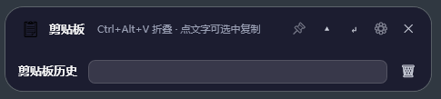
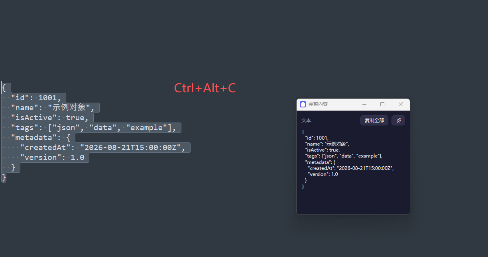

# ClipboardFloat · 悬浮置顶剪贴板

**Windows 上的常驻置顶剪贴板工具：悬浮条永远在上层，点击条目即自动粘贴到当前软件，全程不抢焦点。**

与 Win+V / Ditto / CopyQ 等"弹出面板"式剪贴板工具不同，ClipboardFloat 的交互是**悬浮条形态 + 单击即用**：

```
复制内容 → 悬浮条常驻在目标软件上方 → 单击条目 → 内容自动粘贴进当前软件
```

不需要在软件之间切换层级，不需要"复制 → 切回目标 → 手动粘贴"。

## 功能特性

- **常驻置顶 + 不抢焦点**：`WS_EX_TOPMOST | WS_EX_NOACTIVATE`，悬浮条始终在上层，点击它不打断当前软件
- **单击即粘贴**：点击历史条目 → 自动写入剪贴板并 `Ctrl+V` 到前台窗口（可切换为"仅复制"）
- **一键悬浮查看选中内容**：在任意编辑器选中文字 → `Ctrl+Alt+C` → 自动复制并打开**自动置顶**的完整内容查看窗口
- **完整内容查看窗口**：默认 300×300、自动换行、垂直滚动、支持置顶与复制
- **多格式剪贴板**：文本 / HTML / RTF / 图片 / 文件列表，事件驱动监听（`AddClipboardFormatListener`，零轮询）
- **去重与搜索**：内容哈希去重（重复复制自动置顶条目）、历史实时搜索过滤
- **拖拽**：把历史条目直接拖到任意目标软件
- **SQLite 持久化**：历史与设置保存在 `%LOCALAPPDATA%\ClipboardFloat\`，重启不丢失
- **开机自启动**：设置页一键开启（注册表 Run 项）
- **自定义热键 + 冲突检查**：三个操作热键均可录制；与其他软件占用冲突时**警告但允许保存**
- **单文件分发**：self-contained 单 exe，无需安装 .NET

## 截图





## 使用

### 直接运行

下载 [Release](../../releases) 里的 `ClipboardFloat.exe`（win-x64 自包含单文件，双击即用）。

### 全局热键（默认值，可在设置中自定义）

| 热键 | 功能 |
|---|---|
| `Ctrl+Alt+V` | 呼出/收起历史面板（非置顶状态下唤醒时临时置顶展示） |
| `Ctrl+Alt+P` | 把当前剪贴板内容粘贴到前台窗口 |
| `Ctrl+Alt+C` | 复制选中文字并打开置顶的完整内容查看窗口 |
| `Ctrl+Alt+K` | 修复键盘输入（重置卡住的修饰键），托盘菜单同样可用 |

> 注意：默认热键刻意避开 `Ctrl+Shift` 组合——中文 Windows 上 `Ctrl+Shift` 会被输入法切换器拦截。所有热键可在设置页录制更换，若与其他软件冲突会收到警告但仍可保存。

### 交互

| 操作 | 行为 |
|---|---|
| 单击条目（图标区） | 复制 + 自动粘贴（窄条 ⏎ 按钮可切换自动粘贴） |
| `Ctrl`+单击 | 仅复制 |
| 点击条目右侧 👁 | 快速打开完整内容查看窗口 |
| 点击条目预览文字 | 选中部分文字，`Ctrl+C` 复制选中部分 |
| 右键条目 | 查看完整内容 / 复制 / 复制为纯文本 / 粘贴为纯文本 / 删除 |
| 拖拽条目 | 拖到任意目标软件 |
| 双击托盘图标 | 唤醒并临时置顶展示（与置顶设置无关） |
| 搜索框 | 输入过滤，`Esc` 关闭并归还焦点 |

## 项目结构

```
src/ClipboardFloat.Core/   net8.0 纯逻辑库（可单测）
  ClipItem / ClipboardHistory / ClipboardHtml / ClipboardText
  HistoryStore (SQLite) / Settings / SettingsStore / AppPaths / HotkeyParser
src/ClipboardFloat.App/    net8.0-windows WPF 主程序
  Windows/FloatingWindow   悬浮窗（窄条 + 历史面板）
  Windows/ContentViewerWindow / SettingsWindow
  Services/  ClipboardWatcher / ClipboardSnapshot / ClipboardWriter / PasteService
             HotkeyService / HotkeyRecorder / TopmostService / AutoStartService / AppLog
  ViewModels/ FloatingViewModel / ClipItemViewModel
tests/ClipboardFloat.Tests/ 58 个单元测试
```

## 技术要点

- **不抢焦点**：`WS_EX_NOACTIVATE | WS_EX_TOOLWINDOW`；搜索/文本选择输入时临时允许激活，失焦自动恢复并把前台归还目标应用
- **一键粘贴引擎**：`keybd_event`（VK 码）注入 `Ctrl+V`（实测 `SendInput` 扫描码对 WPF 控件不生效），UIAutomation `ValuePattern` 为兜底；注入后自检，Ctrl 卡键自动补发释放
- **热键注入防串键**：热键回调中注入前先等修饰键全部松开（否则 `Ctrl+Alt+C` 里 Alt 残留会让注入变成 `Ctrl+Alt+C` 而非复制）
- **热键录制**：低级键盘钩子（`WH_KEYBOARD_LL`）能捕获被其他程序 `RegisterHotKey` 占用的按键；冲突探测 = 试注册即释放
- **剪贴板争用防护**：写入放后台专用 STA 线程串行队列（连点不卡 UI、不互相抢剪贴板）；UI 线程异常拦截不退出
- **去重**：内容 SHA-256 哈希，重复复制移动到最前

## 开发

要求：.NET SDK 8.0+

```powershell
# 运行（Debug）
dotnet run --project src/ClipboardFloat.App

# 测试
dotnet test

# 发布单文件 exe（win-x64 自包含，默认输出 ./publish）
.\publish.ps1
# 或指定输出目录
.\publish.ps1 -OutDir D:\some\dir
```

## 已知限制

- 目标软件以管理员运行时，需要本工具也以管理员运行才能注入
- 全屏游戏/独占全屏可能拦截注入
- 应用只允许单实例占用全局热键（重复启动第二个实例时其热键注册失败，日志有记录）

## License

[MIT](LICENSE)
